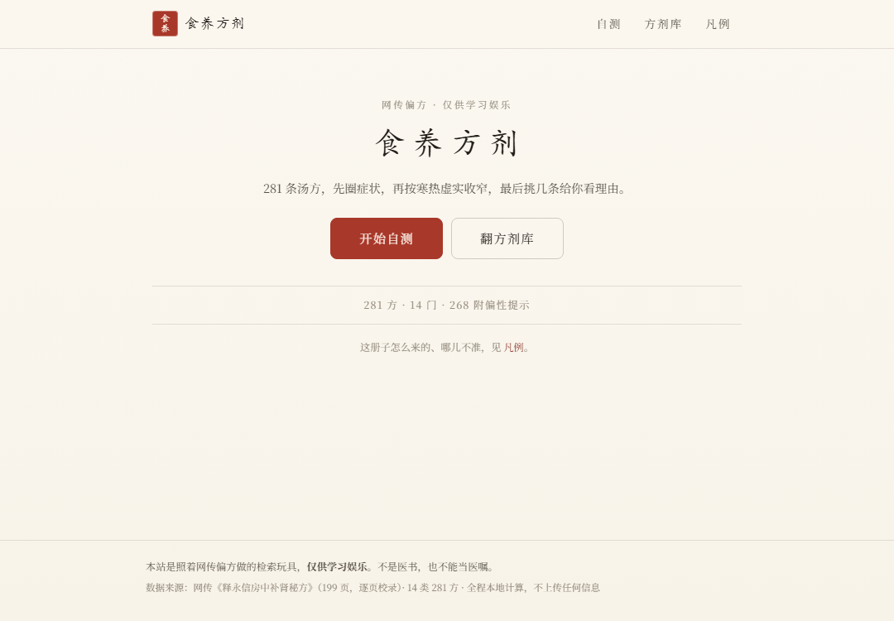

# 食养方剂 · 检索与自测

网传《释永信房中补肾秘方》的结构化整理：**14 类 / 281 方**，可按症状自测收窄范围，也可按门类、证型、风险层级检索。

纯静态站点，无构建、无依赖、无后端。所有作答只在浏览器内计算，不上传、不统计、不留存。

**在线站点**：<https://strawpp.github.io/shiyang-fangji/>



手机端（微信内直接打开，单列、一屏一问）：


> **这是个整理网传偏方的检索玩具，仅供学习娱乐。** 不是医书，不能替代面诊。
> 页面中的「证型倾向」「候选方剂」只是检索排序结果，不是诊断结论，也不是用药推荐。

---

## 它做什么、不做什么

做：把 281 方按症状圈定范围，按寒热虚实收窄，给出 6 条候选，**并把每条为什么被选中摊开**——命中哪些症状、对上哪个证型、与你哪一项体质可能相冲。

不做：不做诊断、不给唯一答案、不提供剂量换算与采购炮制指引、不判断药物相互作用。结果页底部保留一句提醒：血精、睾丸肿块、发热、备孕一年未成功，这些该去医院，不该翻方子。自测不再单设筛查页。

## 本地运行

```bash
git clone https://github.com/Strawpp/shiyang-fangji.git
cd shiyang-fangji
python -m http.server 8000
# 打开 http://localhost:8000
```

> 直接双击 `index.html` 会因为浏览器限制读不到本地 JSON，必须走一个静态服务。

## 目录结构

```
.
├─ index.html                      单页入口（hash 路由）+ 分享卡片元信息
├─ 404.html                        Pages 兜底页
├─ assets/
│  ├─ css/style.css                视觉系统：宣纸底 / 墨字 / 朱印，移动端优先
│  ├─ favicon.svg · og.png         图标与社交分享封面
│  └─ js/
│     ├─ app.js                    路由、自测流程、返回逻辑
│     ├─ data.js                   数据加载与检索索引
│     ├─ quiz.js                   题库、证型权重、打分、答案编码
│     ├─ store.js                  本地存档（结果、历史、筛选状态）
│     └─ ui.js                     各视图渲染
├─ data/
│  ├─ recipes.normalized.json      281 方 + 派生字段，前端直接消费（490 KB / gzip 82 KB）
│  └─ quality-report.md            数据质量报告（每次重建自动生成）
├─ tools/
│  ├─ build-data.py                规范化脚本，可重复运行
│  ├─ herb-safety.json             药材偏性目录（12 类偏性 / 15 类人群）
│  └─ validate.py                  数据自检，CI 与提交前跑
└─ 释永信房中补肾秘方.{md,jsonl}     逐页校录稿与原始结构化数据（底本 PDF 未入库）
```

## 页面

| 路由 | 内容 |
| --- | --- |
| `#/` | 首页：入口 + 上次结果 |
| `#/quiz` | 自测：红线筛查 → 4 题客观症状 → 6 题寒热虚实 |
| `#/result` | 结果：证型倾向 + 6 条候选 + 每条命中依据 + 相冲提示 |
| `#/result?h=…` | 回看某一次历史结果 |
| `#/result?a=…` | 他人分享的结果（打开即看，不覆盖本地记录） |
| `#/history` | 历次自测记录（最多 8 次，90 天过期） |
| `#/library` | 方剂库：关键词、门类、证型、风险层级筛选 |
| `#/r/:id` | 方剂详情：原料 / 制作 / 用法 / 功效 / 宜忌 / 偏性 + 原书页码 |
| `#/about` | 凡例：数据来源、派生字段做法、已知局限 |

## 移动端与状态

站点按微信内打开的 H5 设计：单列、触控目标 ≥ 44px、输入框 16px 字号（避免 iOS 聚焦缩放）、适配 `safe-area-inset`。自测一屏一问，选项大按钮，进度条在顶部。

状态全部留在浏览器（`localStorage`）：

- **自测结果**做完即存，最多保留 8 次，首页顶部出现「上次结果」卡片，导航出现「记录」入口；关掉页面、隔天再来都还在。
- **答题进度**存在 `sessionStorage`，中途切到微信聊天再回来能接着答；交卷后自动清空，下次点「自测」从第一问开始。
- **方剂库筛选**与滚动位置在进出详情时保留，返回不会跳回顶部。
- **返回逻辑**按来源决定：从结果进详情返回结果，从方剂库进详情返回方剂库。自测各题不写历史记录，浏览器返回不会退回上一题。

## 数据

### 数据从哪来

底本是一册 199 页、网上流传的《释永信房中补肾秘方》。它的文本层里，**汉字正确但数字与标点被替换成了一套只有 41 个替身字形的字体**，且每页编码不同——直接抽取会得到 `鲜猪肾 #对$` 这种结果，无法用字符替换表修好。

于是改为：按 150 dpi 渲染每一页 → 逐页重录 → 用文本层的汉字序列做交叉校验（平均相似度 **99.74%**，81 页完全一致）→ 差异处回原页核对。水印与页眉全部剔除。

### 为什么不是「一个症状一个方」

原书从不说明同一症状下几十个方该怎么挑。实测：

- 功效覆盖两个以上症状的方占 **60%**；
- 阳痿一章仅 41 方，但功效里提到阳痿的方有 **110 个**；
- **11 方**功效里不含任何症状关键词，只能靠方剂库触达。

所以「症状 → 唯一答案」在数据上立不住。本站做的是**收窄范围并摊开依据**。

### 派生字段

| 字段 | 做法 | 覆盖 |
| --- | --- | --- |
| `symptoms[]` | 从「适用于……」句式按关键词表抽取 | 270 / 281 |
| `patterns[]` + `pattern_source` | 从功效文字判定证型；原文没写的按治法词兜底，标 `inferred` | 原文 263 + 推断 22 |
| `risk.level` | 甲 药食同源 / 乙 含中药材 / 丙 毒性药、动物药、药酒 | 281 / 281 |
| `caution` | 照抄原书「宜忌」栏 | 仅 36 / 281 |
| `contra` | 按 `tools/herb-safety.json` 查原料成分，推出偏性与需留意人群 | 268 / 281 |

风险分层与偏性判定都是**规则判定，不是临床评估**。丙层条目只做知识展示，页面默认隐藏制法。

### 打分

```
基础分 = 症状命中(0–1) × 0.6 + 证型匹配(0–1) × 0.4
最终分 = 基础分 × 相冲惩罚（每项 −18%，下限 55%）
```

症状权重：主诉 1.0、伴随 0.55；证型权重由寒热虚实题累加后归一，`inferred` 证型向中性收缩 35%。默认排除丙层，取前 6。

**相冲不静默剔除**：问卷只有十题，判错时必须让人看得见原因，所以只降序 + 红字标注「与你的情况可能相冲」。

## 已知局限（不藏）

- **原书禁忌严重缺失**：281 方只有 36 条「宜忌」，其中约一半是「青菜不要久汆」这类烹饪提示。现由成分规则补到 268 条，但规则只认药材偏性，认不出炮制差异、个体过敏与合并用药。
- **18 方既无证型描述、也无法从治法推断**，只能按症状命中。
- **59 方没有核心偏性**（多为常见食材组合），页面显示「未识别出需要提示偏性的药材」。
- 不判断药物相互作用，不判断与西药同服的禁忌，不提供剂量换算与炮制指引。
- `tools/herb-safety.json` 是人工整理的保守表述，覆盖 100 余味常见药材，罕见药材可能漏标，需中医复核。

## 二次开发

```bash
python tools/build-data.py     # 释永信房中补肾秘方.jsonl → data/recipes.normalized.json
python tools/validate.py       # 数据自检，改动后务必跑一次
```

改数据只改三个地方：原始 `jsonl`（文本）、`tools/build-data.py`（词表与规则）、`tools/herb-safety.json`（药材偏性）。`data/` 是产物，不要手改——CI 会重建并比对，不一致直接失败。

前端零依赖、零构建：改 `assets/js/*.js` 直接刷新即可。样式变量集中在 `assets/css/style.css` 顶部 `:root`。

### 欢迎的贡献

1. **中医复核**：`herb-safety.json` 的偏性归类与措辞、`inferred` 证型的正确性。
2. **补禁忌**：为 13 条无偏性提示的药材方补原文或文献依据。
3. **补症状同义词**：`build-data.py` 的 `SECONDARY` 词表，能减少漏标。
4. **界面与可访问性**：键盘操作、屏幕阅读器、对比度。

## 部署

GitHub Pages，`main` 分支根目录，无构建步骤。改完 push 即可，约一分钟生效。

## 许可

- 代码（`index.html`、`assets/`、`tools/*.py`、`.github/`）：**MIT**
- 内容与数据（281 方整理稿、派生标注、药材偏性表）：**CC BY-NC-SA 4.0**

详见 [LICENSE](LICENSE)。底本为民间流传的食疗方册，本项目对其文本做的是整理与检索，未主张原始内容的著作权；若权利人认为不妥，请开 issue 联系。
